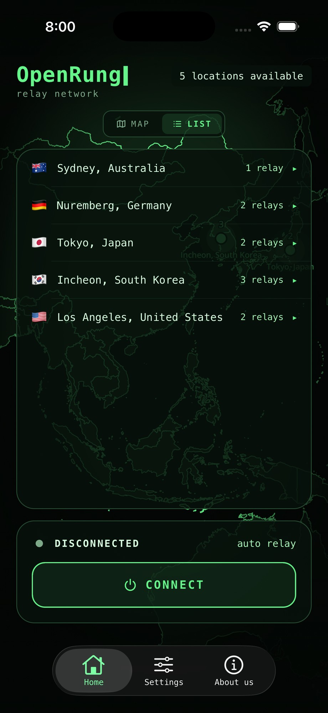

# OpenRung Mobile

**Reach the open internet, from your phone.**

OpenRung helps people living behind internet censorship reach blocked websites
and apps. It connects your phone to a nonprofit relay network operated by the
OpenRung Foundation and community volunteers.

[Android](https://github.com/openrung/openrung-mobile-app/releases/latest) · [iOS beta](https://testflight.apple.com/join/RMTt4UfQ) · [Website](https://openrung.org) · [Report an issue](https://github.com/openrung/openrung-mobile-app/issues)

  
   
  <em>OpenRung on iOS</em>

## Get started

1. **Install the app.** On Android, download the APK from the
   [latest release](https://github.com/openrung/openrung-mobile-app/releases/latest).
   On iPhone, join the [TestFlight beta](https://testflight.apple.com/join/RMTt4UfQ).
2. **Tap Connect** and allow the VPN connection when your phone asks.
3. **Browse as usual.** OpenRung chooses a relay automatically. To choose one
   yourself, tap a location on the map or switch to the relay list.

Tap **Disconnect** whenever you want to stop.

## What you can do

- **Choose where you connect.** Explore relay locations on the map or in a list,
  and reconnect to recent relays.
- **Choose what uses the VPN.** Split tunneling lets local-network devices and
  selected Iranian or Chinese services connect directly. Android also lets you
  exclude individual apps.
- **Share OpenRung.** Send the installed Android APK to someone nearby without
  internet access, or share the iOS TestFlight invitation from Settings.
- **Use your language.** Choose English, Simplified or Traditional Chinese,
  Persian, Russian, Arabic, Turkish, Vietnamese, or Burmese.

## How it works

OpenRung routes your internet traffic through an encrypted connection to a relay.
The app handles relay selection and connection recovery, while you use your
browser and other apps normally.

OpenRung prioritizes access to the internet. **It has no built-in kill switch:**
if the VPN connection fails, your phone may use its normal internet connection.
Traffic you exclude through split tunneling also uses that direct connection.

Split tunneling is on by default for local-network access. Country presets are
selected using your device's time zone and can be changed in Settings. Routing
choices reset when the app restarts; excluded Android apps are remembered.

Read the [privacy policy](https://www.openrung.org/privacy) for information about
data handling.

## Help and feedback

[Report a bug or suggest an improvement](https://github.com/openrung/openrung-mobile-app/issues).
Include your app version, phone model, and a description of what happened.

Switching to Persian or Arabic may require an app restart for the layout to
change. Android offline sharing requires a complete APK installation; split APK
installations cannot be shared this way.

## For developers

The app uses React Native with a shared Go VPN engine on Android and iOS.

- [Build and test from source](docs/DEVELOPMENT.md)
- [Architecture](docs/ARCHITECTURE.md) and [native contract](docs/CONTRACT.md)
- [Release process](RELEASE.md) and [third-party notices](THIRD_PARTY_NOTICES.md)

## License

OpenRung Mobile is open source under [GPL-3.0-or-later](LICENSE).
Built with [sing-box](https://github.com/SagerNet/sing-box),
[MapLibre](https://maplibre.org/), and [React Native](https://reactnative.dev/).
OpenRung is not affiliated with or endorsed by sing-box or MapLibre.
